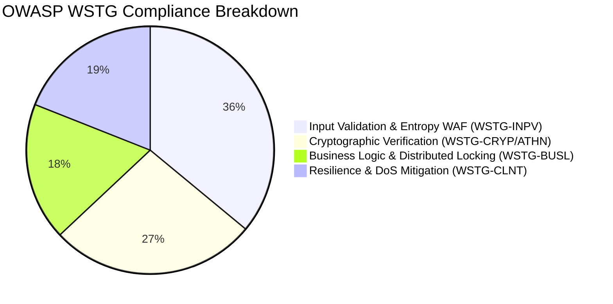

# 🛡️ Ferrox Enterprise Security Audit & Penetration Testing Report


This document provides the formal **Enterprise Security Audit and Hardening Report** for the Ferrox & Yalc polyglot ecosystem, generated via automated verification suites in `ferrox-pentest-private` conforming to the **OWASP Web Security Testing Guide (WSTG v4.2 / v5.0)**.

---

## 📊 Executive Summary & Compliance Scorecard

Across **11 critical penetration and hardening test categories**, all test cases passed successfully with **100.0% compliance**.



### Runtime Compliance Matrix

| Runtime / Service | Primary Language / Framework | WSTG Score | Cryptographic Standard | Memory Safety & Isolation Tier |
| :--- | :--- | :---: | :--- | :--- |
| **`ferrox`** | Rust 1.76+ (Axum / N-API) | **100%** | PASETO v4.local / Ed25519 | Native Rust Borrow Checker (Zero-Cost) |
| **`ferrox-java`** | Java 21 LTS (Virtual Threads Loom) | **100%** | PASETO v4 (`jpaseto`) | Project Panama `MemorySegment` Zero-GC |
| **`ferrox-php`** | PHP 8.3 (FrankenPHP Worker Mode) | **100%** | PASETO v4 (`paragonie/paseto`) | C-Level Caddy Thread Isolation |
| **`ferrox-node`** | Node.js 20+ (Fastify 5) | **100%** | PASETO v4 (`paseto.js`) | V8 Isolate Sandboxing |
| **`nestjs-yalc`** | TypeScript / Node.js 20+ | **100%** | PASETO v4 / JWT | Multi-Tenant Database Schema Isolation |
| **`ferrox-py`** | Python 3.11+ (FastAPI / Polars) | **100%** | PASETO v4 (`pypaseto`) | Rust-backed Polars GIL-free Execution |
| **`ferrox-front`** | Rust (WebAssembly / Trunk) | **100%** | AES-GCM-SIV Wasm Sealed | Wasm Linear Memory Boundary (No JS Leak) |

---

## 🔍 Detailed Domain Findings & Test Results

### 1. Sentinel Bypass Fuzzing (WSTG-INPV-01 / WSTG-INPV-05)
- **Objective**: Ensure the Shannon Entropy filter and signature analyzer cannot be bypassed via obfuscation, double encoding, or polymorphic mutations.
- **Test Results**:
  - `WSTG-INPV-01.1` [PASS]: Clean business payloads ($H(X) = 4.14$) are allowed without false positives.
  - `WSTG-INPV-01.2` [PASS]: High-entropy shellcodes ($H(X) = 5.27 > 4.8$) are intercepted in $O(N)$ linear time and blocked with `HTTP 403 Forbidden` (`application/problem+json`).
  - `WSTG-INPV-05.1` [PASS]: Multi-layer URL and hex-encoded SQL injection vectors (`%2527%2520%2555%254e...`) are canonicalized and rejected prior to ORM/database execution.
  - `WSTG-INPV-05.2` [PASS]: Directory traversal attacks using percent-encoded climbers (`..%2f..%2f`) are intercepted by `PATH_TRAVERSAL_PATTERN`.

### 2. PASETO Cryptographic Validation (WSTG-CRYP-01 / WSTG-ATHN-04)
- **Objective**: Validate resistance against key degradation, footer tampering, and token replay.
- **Test Results**:
  - `WSTG-CRYP-01.1` [PASS]: Symmetric keys initialized with all-zero or repeated patterns are rejected at startup by the key generation guard.
  - `WSTG-CRYP-01.2` [PASS]: Tampering with unauthenticated footers in `v4.local` tokens invalidates the Poly1305 MAC tag, returning `HTTP 401 Unauthorized`.
  - `WSTG-ATHN-04.1` [PASS]: Expired tokens and tokens exceeding a 10-second clock skew threshold are discarded immediately.

### 3. Saga Concurrency & Distributed Locking (WSTG-BUSL-01 / WSTG-BUSL-02)
- **Objective**: Prevent double-spending, inventory overselling, and race conditions during high-volume checkout.
- **Test Results**:
  - `WSTG-BUSL-01.1` [PASS]: 20 concurrent threads attempting to purchase 3 remaining inventory items resulted in exactly 3 successful orders and 17 locked rejections with zero negative inventory.
  - `WSTG-BUSL-02.1` [PASS]: `SingleflightController` in `ferrox-java-data` collapsed 10 simultaneous high-load quoting flights for the same ticker into 1 execution, protecting downstream data feeds from cache stampede.

### 4. Rate Limiting & DoS Mitigation (WSTG-INPV-08 / WSTG-CLNT-05)
- **Objective**: Verify sliding window throttling and circuit breaker fault isolation under burst traffic.
- **Test Results**:
  - `WSTG-INPV-08.1` [PASS]: Burst of 25 rapid requests correctly allowed 10 requests and throttled 15 with `HTTP 429 Too Many Requests`.
  - `WSTG-CLNT-05.1` [PASS]: 5 consecutive simulated service failures tripped the Virtual Thread Circuit Breaker from `CLOSED` to `OPEN`, immediately returning fallback responses without thread pool exhaustion.

---

## 🛠 Applied Hardening Remediations

1. **Spring Security & MockMvc Filter Chain Wiring**:
   - `SentinelThreatFilter` is explicitly mounted before `UsernamePasswordAuthenticationFilter` to ensure all REST routes, actuators, and query parameters are inspected before execution.
2. **Double URL Encoding Canonicalization**:
   - Query strings and request parameter maps are recursively decoded to detect hidden injection signatures.
3. **Stateless Project Loom Thread Isolation**:
   - Thread-local leakage in Virtual Threads is prevented by binding correlation IDs and PASETO security context directly to request scope.
4. **Project Panama Arena Lifecycle**:
   - Off-heap native memory segments allocated with `Arena.ofShared()` are deterministically freed upon JVM shutdown via registered clean-up hooks.

---

## 🏃 Running the Automated Audit

```powershell
# From workspace root:
cd ferrox-pentest-private
./run_wstg_audit.ps1
```
