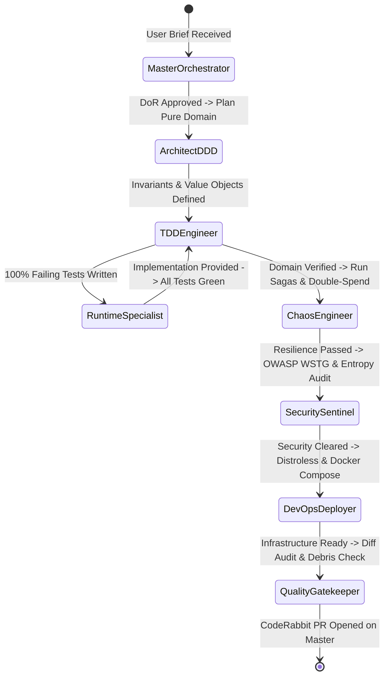

# 🤖 Specialized AI Agents Roster

The **Ferrox Agent Toolkit** provides 10 specialized AI agents. Under the leadership of `ferrox-master-orchestrator`, these agents operate with domain-specific authority, delegating tasks and verifying quality gates across the dual-layer architecture.

---

## 📋 Complete Agent Directory

| Agent Profile | Specification File | Operational Specialty & Mandate |
| :--- | :--- | :--- |
| **`ferrox-master-orchestrator`** | `agents/ferrox-master-orchestrator.md` | Agile Scrum Master, pipeline director, lifecycle governor, and sprint backlog manager. |
| **`ferrox-architect-ddd`** | `agents/ferrox-architect-ddd.md` | Pure domain modeler, aggregate invariants architect, and CQRS contract author. |
| **`ferrox-tdd-engineer`** | `agents/ferrox-tdd-engineer.md` | Red-Green-Refactor master, sub-5ms tests, and 100% line & branch coverage guardian. |
| **`ferrox-security-sentinel`** | `agents/ferrox-security-sentinel.md` | OWASP WSTG auditor, Shannon entropy filter ($H \le 4.8$), and PASETO v4 token verifier. |
| **`ferrox-qa-chaos-engineer`** | `agents/ferrox-qa-chaos-engineer.md` | Concurrency double-spend, distributed Saga compensations, and network chaos tester. |
| **`ferrox-devops-deployer`** | `agents/ferrox-devops-deployer.md` | Distroless containers (<25MB), Redpanda/Kafka, Redis Redlock, and Terraform IaC. |
| **`ferrox-quality-gatekeeper`** | `agents/ferrox-quality-gatekeeper.md` | Fresh-eyes diff audit, DoD verification, CodeRabbit config, and PR submission. |
| **`ferrox-rust-specialist`** | `agents/ferrox-rust-specialist.md` | Rust systems engineer: 1M RPS, zero-alloc `bytes::Bytes`, lock-free concurrency. |
| **`ferrox-wasm-specialist`** | `agents/ferrox-wasm-specialist.md` | Reactive WebAssembly pure UI architect: Signal reactivity, 60 FPS SVG rendering. |
| **`ferrox-polyglot-implementer`** | `agents/ferrox-polyglot-implementer.md` | Inter-language FFI (Panama, PyO3, Node-API) and gRPC/CloudEvents messaging engineer. |

---

## 🤝 Collaborative Agent Interaction Flow

---

## 🎯 Profile Deep Dive

### 1. `ferrox-master-orchestrator`
- **Mission**: Orchestrates the entire Agile development lifecycle from initial user prompt to merged pull request.
- **Key Artifacts**: `AGILE_SPRINT_BACKLOG.md`, `DEFINITION_OF_DONE.md`.
- **Triggers**: Whenever a new feature, epic, or major refactor is requested.

### 2. `ferrox-architect-ddd`
- **Mission**: Designs pure domain boundaries with zero external dependencies.
- **Key Artifacts**: `DDD_PLAN.md`.
- **Enforcement**: Blocks any database, HTTP, or framework imports in domain modules.

### 3. `ferrox-security-sentinel`
- **Mission**: Audits code for vulnerabilities, hardcoded secrets, and cryptographic weaknesses.
- **Key Artifacts**: `SECURITY_AUDIT_REPORT.md`.
- **Enforcement**: Halts pipeline if Shannon entropy exceeds $4.8$ or JWTs are used instead of PASETO v4.
