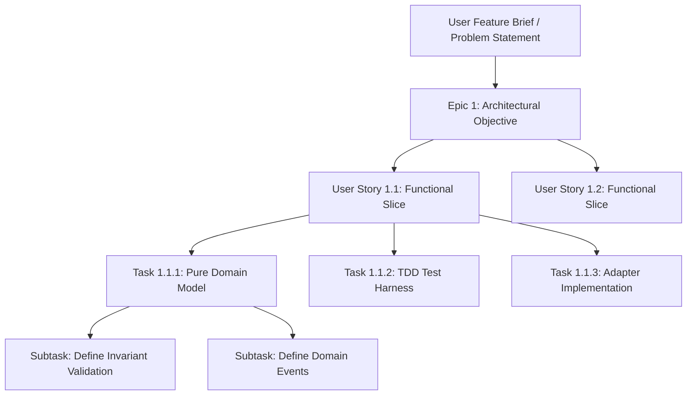

# 📋 Autonomous Agile Scrum Lifecycle

The **Ferrox Agent Toolkit** implements an autonomous Agile Scrum workflow governed by the `ferrox-scrum-master` agent and enforced by `rules/ferrox-agile-scrum-lifecycle.md`.

When an engineer or user provides a feature brief or problem statement, the system does not jump directly to code. Instead, it systematically structures the work through a four-tier hierarchical decomposition with strict readiness and completion gates.

---

## 🏗️ The Four-Tier Task Hierarchy



### Hierarchy Definitions

1. **Epic (`EPIC-<ID>`)**:
   - High-level business or architectural initiative.
   - Example: `EPIC-01: Multi-Currency Payment Gateway with Distributed Saga Compensation`.
2. **User Story (`US-<ID>`)**:
   - Single vertical slice of user or system functionality.
   - Must adhere to the standard formulation:
     ```text
     As a <Role>,
     I want <Capability>,
     So that <Business Value>.
     ```
3. **Atomic Task (`TASK-<ID>`)**:
   - Concrete technical unit of work.
   - Must include Given/When/Then acceptance criteria.
   - Estimated in ideal engineering hours or story points ($1, 2, 3, 5, 8$).
4. **Subtask (`SUB-<ID>`)**:
   - Granular commit-level activity (e.g., "Implement value object validation regex").

---

## 🚪 Definition of Ready (DoR) Gate

Before any story transitions from **Planned** to **In Progress**, the **Definition of Ready** must be satisfied:

- [x] **Clear Business Goal**: Value proposition is explicitly articulated.
- [x] **Acceptance Criteria**: Formatted as formal Given/When/Then test scenarios.
- [x] **Pure Domain Model Specified**: Entities, value objects, and domain events identified.
- [x] **Dependencies Cleared**: External services and Ferrox ecosystem dependencies checked against `rules/ferrox-first-dependency-policy.md`.
- [x] **Security Impact Evaluated**: Auth requirements and sensitive data flows cataloged.

```markdown
> [!IMPORTANT]
> The Definition of Ready (DoR) prevents agents from writing code based on ambiguous requirements. If requirements are underspecified, `ferrox-scrum-master` halts execution and solicits clarification.
```

---

## 🏁 Definition of Done (DoD) Gate

Before any story transitions to **Done**, every item in the **Definition of Done** must be verified:

| Gate | Requirement | Automated Verification Tool |
| :--- | :--- | :--- |
| **Domain Purity** | Zero framework, DB, or I/O imports in domain models | `ferrox-architect-ddd` inspection |
| **Strict TDD** | Tests written before production code | Test harness commit history |
| **100% Coverage** | 100% line coverage and 100% branch coverage | `python scripts/check_coverage.py` |
| **Mutation Testing** | Mutation score indicator ($\text{MSI} \ge 85\%$) | Cargo mutants / Stryker / Infection |
| **Fast Tests** | Pure domain unit tests execute in $< 5\text{ms}$ | Test runner latency metrics |
| **E2E Resilience** | Chaos and distributed Saga rollback tests pass | `E2E_VERIFICATION.md` |
| **Sentinel Security** | OWASP WSTG scan passes with Shannon entropy $H \le 4.8$ | `python scripts/run_wstg_security_scanner.py` |
| **Zero Debris** | Zero `dbg!`, `console.log`, `print`, or `var_dump` calls | `python skills/ferrox-self-reviewer/scripts/scan_diff_debris.py` |
| **Documentation** | Interactive Wasm docs compiled into `ferrox-codex` | `ferrox-codex build` |
| **Git Forge PR** | Pull Request submitted to `master` with CodeRabbit config | `gh pr create --base master` |

---

## 📊 Backlog Artifact (`AGILE_SPRINT_BACKLOG.md`)

The `ferrox-scrum-master` generates and maintains a living sprint backlog markdown artifact at the root of the active project:

```markdown
# 📋 Sprint Backlog: Payment Gateway Saga

## 🎯 Active Sprint Goals
Deliver zero-alloc double-spend resilient multi-currency checkout engine.

## 📌 Epics & Stories

### 🚀 EPIC-01: Pure Domain Checkout Aggregate
- [x] **US-01**: Multi-currency money value object (`DoR: PASSED`, `DoD: PASSED`)
  - [x] `TASK-01.1`: Strict precision scale and ISO 4217 validation.
  - [x] `TASK-01.2`: Immutability tests (< 1ms execution).
- [ ] **US-02**: Distributed Saga Outbox Coordinator (`DoR: PASSED`, `In Progress`)
  - [ ] `TASK-02.1`: Redpanda event publishing.
  - [ ] `TASK-02.2`: Redis Redlock idempotency key validation.
```
