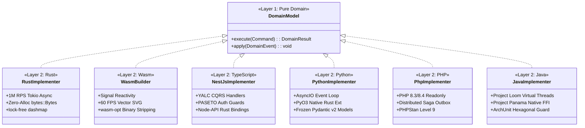

# 🏛️ Dual-Layer Engineering Architecture

The **Ferrox Agent Toolkit** is architected around a strict two-tier division of responsibility. This model ensures that high-level software engineering governance remains invariant regardless of the underlying runtime language, while low-level implementation logic fully leverages the native idioms, zero-cost abstractions, and hardware optimizations of each specific platform.

```
+-----------------------------------------------------------------------------------+
|                   LAYER 1: HIGH-LEVEL AGNOSTIC GOVERNANCE                        |
|                                                                                   |
|  [Agile Scrum Master] -> [Git Forge Lifecycle] -> [Ferrox-First Policy]           |
|            |                                                                      |
|  [Pure DDD Planner]   -> [Strict 100% TDD]     -> [E2E Chaos & Sagas]             |
|            |                                                                      |
|  [Security Sentinel]  -> [DevOps IaC Scaffold] -> [Disciplined Self-Review]       |
|            |                                                                      |
|  [Interactive Codex Documentation]             -> [CodeRabbit AI Pull Request]    |
+-----------------------------------------------------------------------------------+
                                         |
                                         v
+-----------------------------------------------------------------------------------+
|                   LAYER 2: LOW-LEVEL RUNTIME IMPLEMENTERS                         |
|                                                                                   |
|  +---------------------+   +---------------------+   +-------------------------+  |
|  |   Rust Core Server  |   |   Rust Wasm UI      |   |  TypeScript / NestJS    |  |
|  |   (Zero-Alloc RPS)  |   |   (Signal DOM 60FPS)|   |  (YALC CQRS & PASETO)   |  |
|  +---------------------+   +---------------------+   +-------------------------+  |
|  +---------------------+   +---------------------+   +-------------------------+  |
|  |     Python PyO3     |   |   PHP Modern Saga   |   |   Java 21 Loom/Panama   |  |
|  |   (AsyncIO CQRS)    |   |   (PSR-15 Outbox)   |   |   (Virtual Threads)     |  |
|  +---------------------+   +---------------------+   +-------------------------+  |
+-----------------------------------------------------------------------------------+
```

---

## 🛡️ Layer 1: High-Level Agnostic Governance

Layer 1 establishes the rules of engagement for all engineering tasks. It operates completely independent of programming language syntax or framework specifics.

### 1. Agile Scrum Lifecycle (`rules/ferrox-agile-scrum-lifecycle.md`)
Every task begins with rigorous decomposition handled by `ferrox-scrum-master`:
- **Epics**: High-level business initiatives.
- **User Stories**: Functional increments with User Story format (`As a... I want... So that...`).
- **Atomic Tasks**: Technical implementation units with concrete Acceptance Criteria (Given/When/Then).
- **Definition of Ready (DoR)**: Coding cannot begin until the domain model, test contracts, and dependencies are formally ratified.
- **Definition of Done (DoD)**: No story is complete without 100% line & branch coverage, passing security audit, zero debug debris, and merged pull request.

### 2. Git Forge Governance (`rules/ferrox-git-lifecycle-governance.md`)
Automates remote forge interactions via `gh` (GitHub) or `glab` (GitLab):
- Synchronizes with GitHub Milestones and project issues.
- Creates tracked feature branches: `feature/issue-<id>-<slug>`.
- Generates CodeRabbit AI review directives in `.coderabbit.yaml`.
- Submits PRs targeting `master` or `main` with complete test coverage proofs and audit reports.

### 3. Ferrox-First Dependency Policy (`rules/ferrox-first-dependency-policy.md`)
Prevents ecosystem fragmentation and external dependency sprawl:
- Native Ferrox crates (`ferrox`, `ferrox-front`, `ferrox-codex`, `ferrox-py-auth`, `nestjs-yalc`) MUST be evaluated before any third-party crate/package is added.
- Injects standardized dependency matrix into `DEPENDENCY_MATRIX.md`.

### 4. Pure DDD Domain Modeling (`rules/ferrox-ddd-architecture.md`)
Enforces pure domain boundaries:
- Invariants, Entities, Value Objects, and Domain Events must reside in pure domain modules with zero I/O, database, or network references.
- Commands and Queries are strictly segregated following CQRS contracts.

### 5. Strict TDD 100% Coverage (`rules/ferrox-tdd-100-percent.md`)
Enforces the Red-Green-Refactor cycle:
- Tests are written before implementation.
- Domain unit tests execute in $< 5\text{ms}$.
- 100% line and branch coverage verified by `scripts/check_coverage.py`.
- Mutation testing score ($\text{MSI} \ge 85\%$) verified via mutant kill ratios.

### 6. E2E Chaos & Resilience (`rules/ferrox-e2e-chaos-resilience.md`)
Validates distributed systems under failure conditions:
- Simulates concurrent double-spend race conditions.
- Exercises distributed Saga compensation rollbacks and Transactional Outbox consistency.

### 7. Sentinel Security (`rules/ferrox-sentinel-security.md`)
Automates security verification against OWASP WSTG standards:
- Shannon entropy scanner flags secrets and high-entropy literals ($H > 4.8$).
- PASETO v4 token validation with strict AAD footer binding.
- Concurrency locks (Redis Redlock / Tokio mutexes) prevent balance exhaustion races.

### 8. DevOps Infrastructure as Code (`rules/ferrox-devops-infrastructure-iac.md`)
Scaffolds production-grade deployment infrastructure:
- Multi-stage distroless Docker containers with binary sizes under $25\text{MB}$.
- Redpanda/Kafka event bus and Redis cluster orchestration.
- Terraform manifests for cloud or VPS bare-metal deployment.

### 9. Disciplined Self-Review (`rules/ferrox-self-review-standards.md`)
Executes an automated pre-submission diff audit:
- Scans `git diff` against master for forbidden debug statements (`dbg!`, `console.log`, `print`, `var_dump`).
- Validates pure domain invariants and produces `SELF_REVIEW_REPORT.md`.

---

## ⚡ Layer 2: Low-Level Polyglot Implementers

Layer 2 translates the pure domain contracts generated in Layer 1 into ultra-optimized, idiomatically perfect code for the target runtime.



### Supported Runtime Specialties

1. **Rust Core (`ferrox-rust-specialist`)**:
   - High-throughput asynchronous services running on Tokio.
   - Zero-allocation memory pipelines utilizing `bytes::Bytes`.
   - Lock-free concurrent data structures and exhaustive `thiserror` hierarchies.
2. **Rust WebAssembly (`ferrox-wasm-specialist`)**:
   - Zero-JS reactive frontends for `ferrox-front` and `ferrox-codex`.
   - Fine-grained signal state management and 60 FPS SVG rendering.
   - Aggressive binary size optimization using `wasm-opt -Oz`.
3. **TypeScript / NestJS (`ferrox-nestjs-implementer`)**:
   - Enterprise CQRS handlers built on the YALC architecture (`nestjs-yalc`).
   - Node-API native Rust bindings for compute-intensive tasks.
   - Comprehensive Jest test suites with strict 100% threshold enforcement.
4. **Python (`ferrox-python-implementer`)**:
   - High-performance AsyncIO services and PyO3 native Rust extensions.
   - Frozen immutable Pydantic v2 models for domain data validation.
   - Pytest suites targeting 100% coverage with `pytest-cov`.
5. **PHP (`ferrox-php-implementer`)**:
   - Modern PHP 8.3/8.4 services with strict `final readonly` entities.
   - Distributed Saga coordinators and PSR-15 middleware pipelines.
   - PHPStan Level 9 static analysis and Infection mutation testing.
6. **Java (`ferrox-java-implementer`)**:
   - Java 21+ services powered by Project Loom virtual threads.
   - Low-latency off-heap FFI via Project Panama calling Rust native libraries.
   - ArchUnit architectural boundary validation and JaCoCo 100% coverage gates.
