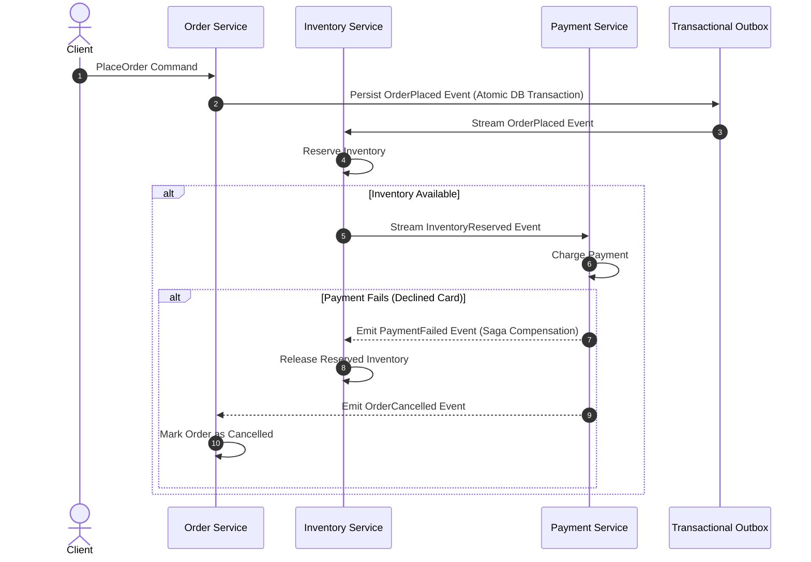

# 🌪️ E2E Chaos Engineering & Distributed Sagas

The **Ferrox Agent Toolkit** validates distributed consistency and disaster resilience through `ferrox-e2e-scaffolder`, `ferrox-qa-chaos-engineer`, and `rules/ferrox-e2e-chaos-resilience.md`.

Distributed systems inevitably experience node crashes, packet drops, clock skews, and split-brain scenarios. Ferrox services must prove fault tolerance before deployment.

---

## 🔄 Distributed Saga Choreography & Compensation

### Saga Verification Rules:
1. **Idempotent Handlers**: Every event consumer must deduplicate events using an idempotency key before processing.
2. **Deterministic Compensations**: For every forward action (e.g. `ReserveInventory`), a corresponding compensation action (e.g. `ReleaseInventory`) must exist and pass verification.
3. **Transactional Outbox**: Events must never be published directly to message queues within an open database transaction. They must be saved into a local `outbox` table atomically with the business entity, then relayed asynchronously.

---

## ⚡ Concurrency Chaos & Double-Spend Tests

The toolkit executes automated concurrent chaos tests:
- **100-Concurrent Race Harness**: 100 concurrent async tasks trigger withdrawal of the same account balance simultaneously.
- **Verification Criterion**: Exactly one request succeeds with HTTP 200/201; 99 requests fail with deterministic HTTP 409 Conflict / Insufficient Funds; total debited amount equals exactly one transaction fee.
- **Output Artifact**: Verified and recorded into `E2E_VERIFICATION.md`.
