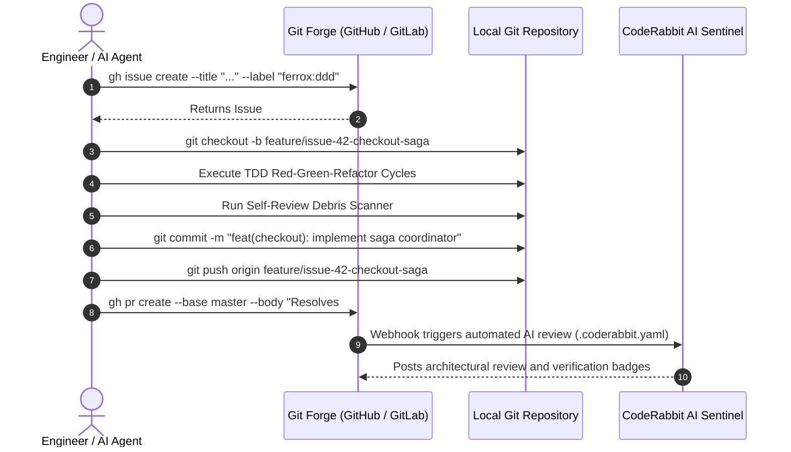

# 🐙 Git Forge Governance & Pull Request Automation

The **Ferrox Agent Toolkit** automates all remote forge interactions via the `ferrox-forge-lifecycle` skill and agent, governed by `rules/ferrox-git-lifecycle-governance.md`. It eliminates manual context switching between the terminal and browser interfaces, orchestrating seamless collaboration across GitHub and GitLab.

---

## 🔄 Forge Lifecycle Workflow



---

## 🏷️ Standardized Taxonomy & Labels

All issues, PRs, and milestones carry strict Ferrox taxonomy labels:

| Label Category | Prefix | Examples |
| :--- | :--- | :--- |
| **Layer** | `layer:` | `layer:agnostic`, `layer:runtime-rust`, `layer:runtime-wasm` |
| **Architecture** | `arch:` | `arch:ddd`, `arch:cqrs`, `arch:saga`, `arch:outbox` |
| **Quality** | `quality:` | `quality:tdd-100`, `quality:sentinel-sec`, `quality:chaos-verified` |
| **Status** | `status:` | `status:ready-dor`, `status:in-review`, `status:blocked` |

---

## 🌿 Branch Naming Conventions

All branches created by the toolkit must conform to the standardized regex pattern:

```text
^(feature|bugfix|refactor|docs|chore)/issue-\d+-[a-z0-9-]+$
```

### Valid Examples:
- `feature/issue-42-checkout-saga`
- `bugfix/issue-89-paseto-token-clock-skew`
- `refactor/issue-104-zero-alloc-bytes-deserializer`

---

## 🤖 CodeRabbit AI Configuration (`.coderabbit.yaml`)

The toolkit automatically provisions a `.coderabbit.yaml` file in target repositories to enforce rigorous AI-to-AI peer reviews:

```yaml
version: "2"
language: "en-US"
tone_instructions: "Strict, objective, uncompromising engineering rigor conforming to Ferrox polyglot guidelines."
reviews:
  profile: "assertive"
  request_changes_workflow: true
  high_level_summary: true
  auto_review:
    enabled: true
    drafts: false
    base_branches:
      - "master"
      - "main"
  path_instructions:
    - path: "**/domain/**"
      instructions: "Reject ANY external framework dependencies, database imports, or I/O calls. Pure DDD only."
    - path: "**/tests/**"
      instructions: "Verify 100% line and branch coverage. Verify sub-5ms pure domain test execution."
```

---

## 🚀 Pull Request Submission Standards

When submitting a Pull Request, `ferrox-quality-gatekeeper` generates a comprehensive body including all verification artifacts:

```bash
gh pr create \
  --base master \
  --title "feat(checkout): implement distributed saga compensation coordinator (#42)" \
  --body-file PULL_REQUEST_TEMPLATE.md
```

### Required PR Sections:
1. **Summary & Problem Statement**: Clear explanation of business value.
2. **Related Issue**: `Resolves #<id>`.
3. **Domain Architectural Decisions**: Summary of aggregate boundaries and CQRS commands.
4. **100% Coverage Proof**: Line & branch coverage report output from `scripts/check_coverage.py`.
5. **Security Audit Proof**: Shannon entropy scan results and PASETO v4 token validation from `scripts/run_wstg_security_scanner.py`.
6. **Self-Review Confirmation**: Verified zero debug debris (`dbg!`, `console.log`, `print`).
