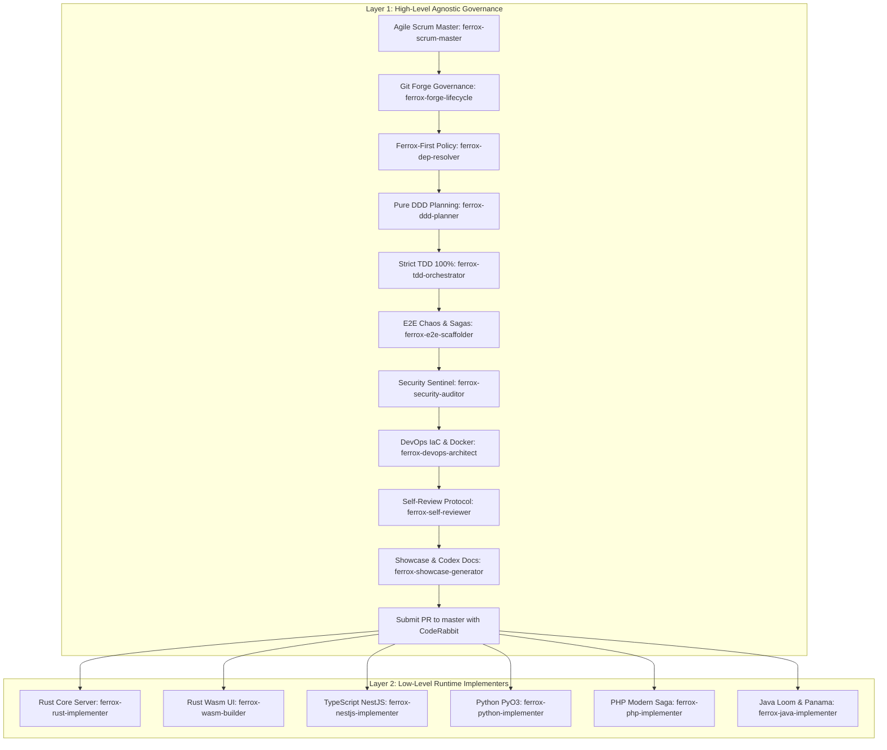

# 🛡️ Ferrox Agent Toolkit Overview

Welcome to the **Ferrox Agent Toolkit** — the enterprise dual-layer engineering framework designed specifically for autonomous AI coding agents and human engineers building within the **Ferrox polyglot ecosystem**.

The toolkit provides a standardized operating system for AI agents, enforcing strict Agile Scrum workflows, pure Domain-Driven Design (DDD), 100% test coverage with sub-5ms test execution, OWASP WSTG Sentinel Security, zero-downtime DevOps infrastructure, and native polyglot connectors.



---

## 🌟 Core Pillars

| Pillar | Principle | Standard Enforcement |
| :--- | :--- | :--- |
| **Dual-Layer Architecture** | Clean separation of concerns | Layer 1 handles architectural governance; Layer 2 provides runtime implementations. |
| **Autonomous Agile Scrum** | Disciplined feature decomposition | User briefs decompose into Epics, Stories, and Atomic Tasks with formal DoR & DoD gates. |
| **Ferrox-First Dependency** | Zero bloat, native ecosystem reuse | Prioritize `ferrox`, `ferrox-front`, `ferrox-codex`, and `nestjs-yalc` before external crates. |
| **Pure DDD Isolation** | Zero framework leakage | Domain entities and value objects have no dependencies on frameworks or IO layers. |
| **Strict 100% TDD** | Red-Green-Refactor guarantee | Tests written before production code; 100% line & branch coverage; mutation score $\ge 85\%$. |
| **Sentinel Security** | OWASP WSTG v4.2/v5.0 compliance | Shannon entropy secrets filter ($H \le 4.8$), PASETO v4 token security, and atomic concurrency guards. |
| **Zero-Downtime DevOps** | Distroless & Cloud-Native | Distroless Docker images ($< 25\text{MB}$), Redpanda/Kafka streams, Redis state, Terraform IaC. |
| **Live Wasm Documentation** | Single-source of truth | All features documented with interactive WebAssembly sandboxes rendered on `ferrox-codex`. |

---

## 📦 What's Inside

The toolkit is organized into three primary operational assets:

1. **19 Engineering Rules (`rules/`)**: Behavioral mandates and quality standards covering Agile lifecycles, Git forge management, DDD, TDD, security audits, Docker/IaC, and runtime-specific paradigms for Rust, Wasm, TypeScript/NestJS, Python, PHP, and Java.
2. **19 Specialized Skills (`skills/`)**: Autonomous capabilities with executable automation scripts (coverage scanners, entropy analyzers, diff debriefer, IaC generators, and code reviewers).
3. **10 Autonomous Agent Profiles (`agents/`)**: Specialized AI personas orchestrated by `ferrox-master-orchestrator` to execute multi-agent collaborative workflows.

---

## 🚀 Quick Start

### 1. Global Installation (Antigravity IDE)

To install globally into your Antigravity IDE configuration:

```powershell
# PowerShell (Windows)
powershell -ExecutionPolicy Bypass -File .\scripts\install.ps1 -Target antigravity
```

```bash
# Bash (Linux/macOS)
./scripts/install.sh antigravity
```

### 2. Workspace Linking (.agents)

To equip all repositories within your development workspace:

```powershell
powershell -ExecutionPolicy Bypass -File .\scripts\install.ps1 -Target workspace -WorkspaceDir "C:\Users\nn\Desktop\code"
```

This creates live NTFS Junctions (or symlinks on POSIX) for `.agents/rules`, `.agents/skills`, and `.agents/agents`, plus copies `AGENTS.md` to your workspace root.

---

## 📖 Next Steps

- Explore the [Dual-Layer Architecture](./architecture) to understand the governance hierarchy.
- Learn about the [Autonomous Agile Scrum](./agile-scrum) pipeline.
- Review [Strict TDD & Quality Gates](./strict-tdd-and-quality) for coverage enforcement.
- Inspect the [Specialized Agents Roster](./agents-roster) to see who does what.
