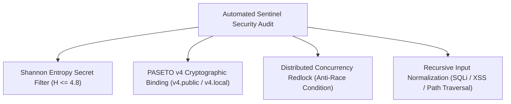

# 🛡️ OWASP WSTG Sentinel Security Architecture

The **Ferrox Agent Toolkit** integrates automated penetration testing and security auditing through the `ferrox-security-auditor` skill and `rules/ferrox-sentinel-security.md`.

Security is embedded directly into the developer workflow, evaluating pull requests and diffs against the **OWASP Web Security Testing Guide (WSTG v4.2/v5.0)** before any code reaches production.

---

## 🔍 Core Security Pillars



---

## 1. Shannon Entropy Secret Filter ($H \le 4.8$)

The toolkit runs an automated entropy scanner (`scripts/run_wstg_security_scanner.py`) to prevent hardcoded API keys, private keys, and high-entropy credentials from being committed:

$$\text{Shannon Entropy: } H(X) = -\sum_{i=1}^{n} P(x_i) \log_2 P(x_i)$$

- Strings with an entropy score exceeding **$4.8$** and length $> 16$ characters are automatically flagged as suspected secrets.
- Commits and pull requests containing flagged literals are rejected by the quality gatekeeper.

```bash
# Run security scanner manually
python scripts/run_wstg_security_scanner.py --path ./src
```

---

## 2. PASETO v4 Cryptographic Token Binding

The Ferrox ecosystem adopts **PASETO (Platform-Agnostic Security Tokens) v4** instead of legacy JSON Web Tokens (JWT):

| Feature | Legacy JWT | Ferrox PASETO v4 |
| :--- | :--- | :--- |
| **Cipher Negotiation** | Vulnerable to `none` algorithm exploits | Fixed, modern cryptography only |
| **Public Tokens (`v4.public`)** | RSA / ECDSA malleability risks | Ed25519 asymmetric signatures |
| **Local Tokens (`v4.local`)** | HMAC-SHA256 secret collisions | XChaCha20-Poly1305 AEAD authenticated encryption |
| **AAD Footer Binding** | Rare or non-standard | Mandatory tenant / audience binding in token footer |

### Security Invariants:
1. Tokens must carry an expiration timestamp (`exp`) not exceeding $15\text{ minutes}$ for access tokens.
2. The Additional Authenticated Data (`AAD`) footer must bind tenant ID and origin to prevent cross-tenant token replay.

---

## 3. Concurrency Double-Spend Prevention

To eliminate race conditions in financial transactions and balance debits:
- Every state mutation involving balances, inventory, or shared resources must acquire a distributed lock (e.g., Redis Redlock) or execute within an atomic compare-and-swap (CAS) database constraint.
- Stress testing harnesses simulate $100$ concurrent requests attempting to exhaust a single balance simultaneously. The system must permit exactly one success and return idempotent responses for the remainder.

---

## 4. Recursive Input Normalization

All user-supplied inputs must undergo recursive normalization before reaching CQRS command handlers:
- **Unicode Canonicalization**: UTF-8 NFC normalization prevents homograph and bypass attacks.
- **Path Traversal Shield**: Paths are stripped of `../` sequences and canonicalized against safe root sandboxes.
- **SQL / Injection Neutralization**: Strict parameter binding; zero dynamic SQL string interpolation permitted under any circumstances.
