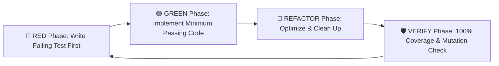

# 🧪 Strict 100% TDD & Quality Gate Enforcement

The **Ferrox Agent Toolkit** enforces Test-Driven Development (TDD) as a non-negotiable engineering standard through `ferrox-tdd-orchestrator` and `rules/ferrox-tdd-100-percent.md`.

In the Ferrox ecosystem, **tests are not an afterthought written after code is delivered**; they are the formal executable specification of system behavior written prior to implementation.

---

## 🔴 The Red-Green-Refactor Cycle



1. **🔴 Red Phase**: Write a failing unit test asserting the expected behavior, boundary condition, or invariant violation. The test must fail for the correct reason (compilation error or assertion failure).
2. **🟢 Green Phase**: Write the simplest, cleanest production code required to make the test pass. Avoid speculative logic or premature over-engineering.
3. **🔵 Refactor Phase**: Eliminate duplication, optimize allocations (e.g. using `bytes::Bytes`), and refine naming while keeping all tests passing.
4. **🛡️ Verify Phase**: Run automated coverage and mutation analysis tools. If line coverage < 100% or branch coverage < 100%, write additional tests immediately.

---

## ⚡ Sub-5ms Test Execution Policy

Pure domain logic must execute orders of magnitude faster than traditional integrated test suites.

- **Threshold**: All pure domain unit tests MUST complete in $< 5\text{ms}$ per test case.
- **Enforcement**: Tests that touch disk I/O, network sockets, sleeps, or process spawns are strictly categorized as **Integration** or **E2E** tests and isolated into separate test directories (`tests/integration/` or `tests/e2e/`).

---

## 📊 100% Coverage Verification (`scripts/check_coverage.py`)

The toolkit provides an automated polyglot test coverage scanner (`scripts/check_coverage.py`) supporting:
- **Rust**: `cargo llvm-cov --lcov`
- **TypeScript / Jest**: `jest --coverage --coverageReporters="lcov"`
- **Python**: `pytest --cov --cov-report=lcov`
- **PHP**: `phpunit --coverage-clover`
- **Java**: `mvn test jacoco:report`

```bash
# Execute universal coverage checker
python scripts/check_coverage.py --threshold 100
```

### Coverage Report Example:
```text
============================================================
  🛡️  FERROX STRICT 100% COVERAGE VERIFICATION
============================================================
Scanning coverage reports in: ./coverage/
  -> Found lcov.info report

File Breakdown:
  • src/domain/aggregates/checkout.rs  : 100.0% (Lines: 42/42, Branches: 8/8)
  • src/domain/values/money.rs         : 100.0% (Lines: 28/28, Branches: 6/6)
  • src/domain/events/payment.rs       : 100.0% (Lines: 15/15, Branches: 2/2)

Summary:
  • Total Lines Covered   : 85 / 85 (100.0%)
  • Total Branches Covered: 16 / 16 (100.0%)
  • Quality Gate Result   : ✅ PASSED (100% Threshold Satisfied)
============================================================
```

---

## 🧬 Mutation Testing Score ($\ge 85\%$ MSI)

Code coverage alone can be deceptive if assertions are weak or superficial. The toolkit enforces **Mutation Testing**:

1. Small synthetic mutations are introduced into source code (e.g., swapping `>` for `>=`, flipping `true` to `false`, omitting function returns).
2. The test suite is re-executed against each mutant.
3. The mutant is **Killed** if a test fails. If tests pass, the mutant **Survives** (indicating insufficient test assertions).
4. The Mutation Score Indicator ($\text{MSI}$) must satisfy:
   $$\text{MSI} = \frac{\text{Mutants Killed}}{\text{Total Mutants}} \ge 85\%$$
