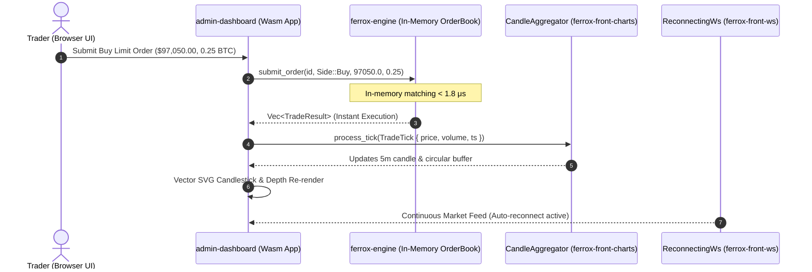

import FerroxWasmPlayground from '@site/src/components/FerroxWasmPlayground';

# Interactive WebAssembly Live Trading Desk

This page hosts the enterprise reference application **Ferrox Live Trading Desk**, compiled for target **`wasm32-unknown-unknown`** and executing natively inside your web browser.

No external JavaScript runtime, no React bundle overhead: fine-grained reactivity, the in-memory order book matching engine, and pure vector chart rendering are powered directly by the WebAssembly virtual machine.

---

## 🎮 Interactive Live Playground

You can interact directly with the embedded application below: switch tabs, simulate real-time market trade ticks, inspect vector order book depth, and submit instant buy and sell orders.

<FerroxWasmPlayground 
  initialTab="trading" 
  height="820px" 
  title="Ferrox Trading Desk Pro • In-Memory Matching Engine" 
/>

---

## 🏛️ DRY Architecture: Component Integration

The Trading Desk embodies the **DRY (Don't Repeat Yourself)** architectural standard: it contains no duplicated logic, composing exclusively public core libraries from the Ferrox ecosystem:



### 1. In-Process Rust Matching Engine (`ferrox-engine`)
Unlike traditional web architectures where every order submission requires a network round-trip to a remote server (introducing 30–150 ms of network latency), Ferrox Front integrates the `ferrox-engine` crate compiled directly as a pure Rust dependency:
- **In-Memory Execution**: Orders match instantly against a fixed-point `BTreeMap` liquidity tree (`1e8` scalar).
- **Latency &lt; 1.8 Microseconds**: Ideal for zero-latency local simulations, client-side algorithmic backtesting, and offline operation.
- **Universal Portability**: The exact same order book codebase powers both high-throughput backend services (Linux/x86_64) and client browser runtimes (Wasm).

### 2. High-Performance Vector Rendering (`ferrox-front-charts`)
- **`financial_technical_chart`**: 5-minute Candlestick chart featuring SMA 20/50 overlays, Bollinger Bands (±2σ), and integrated RSI and MACD indicator sub-charts.
- **`depth_chart`**: Cumulative Bid/Ask liquidity curves featuring mid-market price markers and automatic bid-ask spread badges.
- **`CandleAggregator`**: Reactive aggregation of discrete market ticks into current open interval candles.

### 3. Resilient Connectivity Protocol (`ferrox-front-ws`)
- **`ReconnectingWs`**: WebSocket client managing full connection lifecycles, exponential backoff retries (`delay * 1.5`), and randomized jitter (±20%) to mitigate thundering herd reconnect storms.
- **Offline Queue Buffer**: Messages dispatched during transient network partitions are buffered in memory and flushed immediately upon session recovery.

---

## 🧪 Running the Trading Desk Locally

To launch and experiment with the Trading Desk in your local environment:

```bash
# 1. Navigate to the showcase application directory
cd ferrox-front/examples/admin-dashboard

# 2. Start the development server with Trunk hot-reloading
trunk serve --open
```

The application will start at `http://localhost:8080/` with instant live-reloading on every Rust source code edit!
