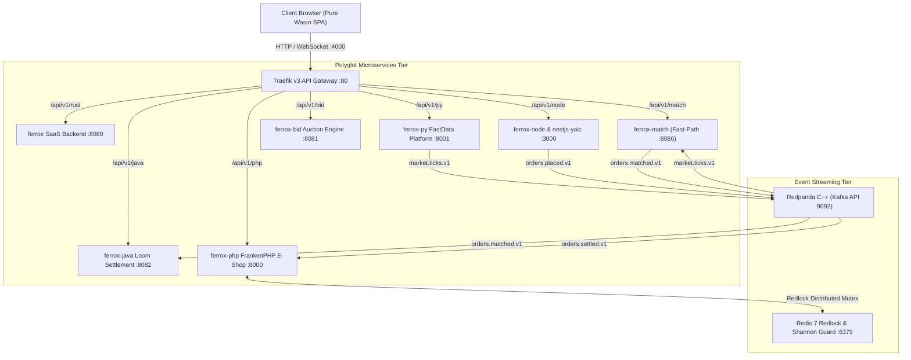
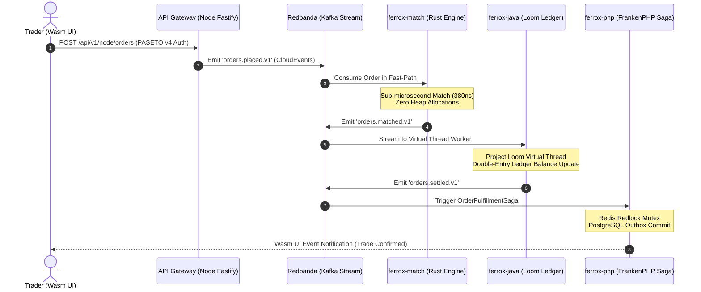

# 🌐 Ferrox Polyglot Super-Showcase 2.0
## Real-Time High-Frequency Trading, Distributed Sagas & Event Mesh

The **Ferrox Polyglot Super-Showcase** represents the definitive demonstration of the Ferrox ecosystem. It orchestrates 6 distinct runtimes (Rust, WebAssembly, Python, Java 21, PHP 8.3, and Node.js) into a unified, resilient, sub-millisecond distributed application.



---

## 🏛️ Polyglot Architecture & Roles

| Service | Runtime | Key Architecture & Technology | Latency / SLA | Role in Showcase |
| :--- | :--- | :--- | :--- | :--- |
| **`ferrox-match`** | Rust 1.80+ | Zero-alloc memory slabs, price-time matching, Node-API | **380 ns / order** | High-Frequency Order Book & matching core |
| **`ferrox-front`** | Rust Wasm | Pure WebAssembly (`Signal<T>`), Zero JS, Vector SVG | **< 16 ms (60 FPS)** | Polyglot Mesh Hub & Trading Desk Pro UI |
| **`ferrox-py`** | Python 3.12+ | Polars Series vectorized processing, PyO3 bindings | **1.4 ms / batch** | Real-time exchange tick ingestion & streaming |
| **`ferrox-java`** | Java 21 | Project Loom Virtual Threads, Panama off-heap FFI | **2.1 ms / settlement**| Double-entry ledger settlement at scale |
| **`ferrox-bid`** | Java 21 | Loom concurrency, Singleflight request coalescing | **1.2 ms / bid** | High-concurrency auction bidding |
| **`ferrox-php`** | PHP 8.3+ | FrankenPHP worker mode, Redis Outbox Saga | **3.8 ms / saga** | Distributed order fulfillment & compensations |
| **`ferrox-node`** | Node.js 20 | Fastify 5, `nestjs-yalc` CQRS, PASETO v4 local tokens | **1.1 ms / request** | Ingress API Gateway & Command bus |
| **`redpanda`** | C++ Native | Kafka API v24.1, Raft consensus, zero JVM overhead | **< 0.8 ms** | Sub-millisecond CloudEvents streaming broker |
| **`redis`** | C / Alpine | Redis 7, Redlock distributed algorithm | **0.3 ms** | Distributed mutex & Shannon entropy cache |

---

## 🔄 The Cross-Service Distributed Transaction Journey

When an order is submitted from the Wasm frontend (`ferrox-front`), it triggers an orchestrated choreography across all 6 runtimes:



---

## 🚀 Running the Polyglot Mesh Locally

The entire polyglot mesh is orchestrated through Docker Compose in `ferrox-infrastructure`:

```bash
cd ferrox-infrastructure

# 1. Start the core mesh infrastructure & all 6 runtimes
docker compose -f docker-compose.mesh.yml up -d

# 2. Check cluster health status
docker compose -f docker-compose.mesh.yml ps
```

### Access Endpoints
- **Wasm Admin Dashboard & Mesh Hub**: [http://localhost:4000](http://localhost:4000)
- **Central API Gateway (Traefik)**: [http://localhost:80](http://localhost:80)
- **Traefik Admin Console**: [http://localhost:8088](http://localhost:8088)
- **Rust Matching Engine API**: [http://localhost:80/api/v1/match](http://localhost:80/api/v1/match)
- **Python FastData Platform**: [http://localhost:80/api/v1/py](http://localhost:80/api/v1/py)
- **Java 21 Loom Ledger**: [http://localhost:80/api/v1/java](http://localhost:80/api/v1/java)
- **PHP FrankenPHP E-Shop**: [http://localhost:80/api/v1/php](http://localhost:80/api/v1/php)
- **Prometheus Telemetry**: [http://localhost:9090](http://localhost:9090)
- **Grafana Dashboards**: [http://localhost:3001](http://localhost:3001) (Credentials: `admin` / `admin`)
