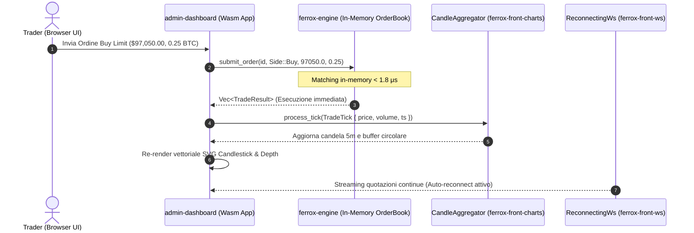

import FerroxWasmPlayground from '@site/src/components/FerroxWasmPlayground';

# Live Trading Desk Interattivo WebAssembly

Questa pagina ospita l'applicazione di riferimento enterprise **Ferrox Live Trading Desk**, compilata per target **`wasm32-unknown-unknown`** ed eseguita nativamente all'interno del tuo browser.

Nessun runtime JavaScript esterno, nessun bundle React: tutta la reattività, il matching engine dell'order book e il rendering vettoriale dei grafici sono eseguiti direttamente dalla macchina virtuale WebAssembly.

---

## 🎮 Playground Interattivo Live

Puoi interagire direttamente con l'applicazione sottostante: naviga tra i tab, simula tick di mercato in tempo reale, consulta l'order book depth vettoriale ed esegui ordini di acquisto e vendita istantanei.

<FerroxWasmPlayground 
  initialTab="trading" 
  height="820px" 
  title="Ferrox Trading Desk Pro • In-Memory Matching Engine" 
/>

---

## 🏛️ Architettura DRY: Integrazione dei Componenti

Il Trading Desk è l'incarnazione della **Regola Architetturale Fondamentale (DRY)**: non contiene logica duplicata, ma compone esclusivamente le librerie core pubbliche dell'ecosistema Ferrox:



### 1. Motore di Matching Rust In-Process (`ferrox-engine`)
A differenza delle architetture web convenzionali dove ogni sottomissione di ordine richiede un round-trip di rete verso un server (introducendo una latenza di 30-150 ms), Ferrox Front integra la crate `ferrox-engine` compilata come modulo Rust puro:
- **Esecuzione In-Memory**: Gli ordini vengono confrontati all'istante contro l'albero di liquidità `BTreeMap` a virgola fissa (`1e8`).
- **Latenza &lt; 1.8 Microsecondi**: Ideale per simulazioni a latenza zero, test di strategie algoritmiche client-side e ambienti offline.
- **Portabilità Totale**: Lo stesso identico codice sorgente dell'order book alimenta sia il microservizio backend ad alte prestazioni (Linux/x86_64) sia il browser client (Wasm).

### 2. Rendering Vettoriale ad Alte Prestazioni (`ferrox-front-charts`)
- **`financial_technical_chart`**: Candlestick 5m con SMA 20/50, Bande di Bollinger (±2σ) e indicatori RSI e MACD integrati.
- **`depth_chart`**: Curva cumulativa Bids/Asks con evidenziazione del mid-market price e badge calcolato per lo spread bid-ask.
- **`CandleAggregator`**: Aggregazione reattiva di singoli tick di mercato all'interno della candela aperta corrente.

### 3. Protocollo di Connettività Resiliente (`ferrox-front-ws`)
- **`ReconnectingWs`**: Client WebSocket con gestione del ciclo di vita della connessione, retry esponenziale (`delay * 1.5`) e jitter casuale (±20%) per prevenire picchi simultanei di riconnessione (Thundering Herd).
- **Buffer di Coda Offline**: Qualsiasi messaggio inviato durante un'interruzione di rete temporanea viene accodato in memoria e recapitato immediatamente al ripristino della sessione.

---

## 🧪 Come Avviare il Trading Desk in Locale

Se desideri eseguire e personalizzare il Trading Desk nel tuo ambiente locale:

```bash
# 1. Posizionati nella directory dell'applicazione showcase
cd ferrox-front/examples/admin-dashboard

# 2. Avvia il server di sviluppo con hot-reloading (Trunk)
trunk serve --open
```

L'applicazione si avvierà all'indirizzo `http://localhost:8080/` con live reload immediato ad ogni modifica al codice Rust!
