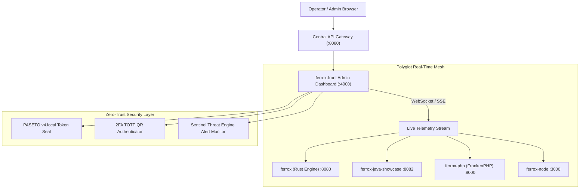

# ⚡ Ferrox Front Enterprise Admin Dashboard 2.0 (Rust / Wasm)

-orange.svg)

-blue.svg)


Enterprise Reference Admin Dashboard built with **Ferrox Front** WebAssembly, demonstrating seamless full-stack integration with the 6 polyglot backend runtimes (`ferrox` Rust, `ferrox-java`, `ferrox-php`, `ferrox-node`, `nestjs-yalc`, `ferrox-py`) via an API Gateway and real-time WebSockets.

---

## 🏛 Architectural Highlights



---

## 🚀 Key Features

1. **Configurable Mesh Gateway Endpoint**:
   - Dynamic gateway URL resolution via `VITE_API_GATEWAY_URL`, `window.FERROX_GATEWAY_URL`, or interactive UI configuration.
2. **Zero-Trust PASETO v4 & 2FA TOTP Flow**:
   - Authenticate with cryptographic `v4.local` symmetric tokens (XChaCha20-Poly1305).
   - Dynamic 2FA TOTP setup with interactive SVG QR Code generation and 6-digit code validation.
3. **Polyglot Real-Time Monitoring Panel**:
   - **Distributed Saga Stream**: Live lifecycle transitions (`ORDER_CREATED` -> `STOCK_RESERVED` -> `PAYMENT_CHARGED` -> `SAGA_COMPLETED`).
   - **Sub-Millisecond Engine Telemetry**: Real-time order matching latency from `ferrox` (0.04ms) and `ferrox-java` Virtual Threads (1.1ms).
   - **Sentinel Threat Alerts**: Live stream of blocked attacks (Shannon Entropy anomalies, SQLi, XSS, Path Traversal) with HTTP 403 RFC 7807 problem details.
4. **Virtualized DataGrid**:
   - Preloaded with 1,000,000 transactions smoothly rendered at 60 FPS via Virtual DOM.
5. **Dynamic Glassmorphism Theming**:
   - Instant theme switching between Cyber, Ocean, Midnight Forest, Sunset Glow, and Corporate Slate.

---

## 🛠 Local Development & Execution

### Option 1: Run with Trunk (Hot-Reload Wasm)
```bash
# Ensure wasm target is installed
rustup target add wasm32-unknown-unknown

# Start local dev server
trunk serve --port 4000 --open
```

### Option 2: Run with Docker Compose
```bash
cd ferrox-front/examples/admin-dashboard
docker compose up -d --build
# Open http://localhost:4000
```

---

## 📡 Gateway Routes Mapped

| Route Prefix | Target Runtime Service | Port | Description |
| :--- | :--- | :--- | :--- |
| `/api/v1/rust/*` | `ferrox-saas-backend` | 8080 | Rust High-Frequency Matching & LOB |
| `/api/v1/java/*` | `ferrox-java-showcase` | 8082 | Java 21 Loom & Panama Off-Heap Cache |
| `/api/v1/php/*` | `ferrox-php/eshop` | 8000 | FrankenPHP Distributed Saga E-Shop |
| `/api/v1/node/*` | `ferrox-node/showcase` | 3000 | Fastify Modular Microservice |
| `/api/v1/nest/*` | `nestjs-yalc/task` | 3002 | Clean Architecture Multi-Tenant Service |
| `/api/v1/py/*` | `ferrox-py/data_platform`| 8001 | FastAPI & Polars High-Throughput Analytics |
| `/*` | `ferrox-front` | 4000 | Wasm Admin Dashboard |
